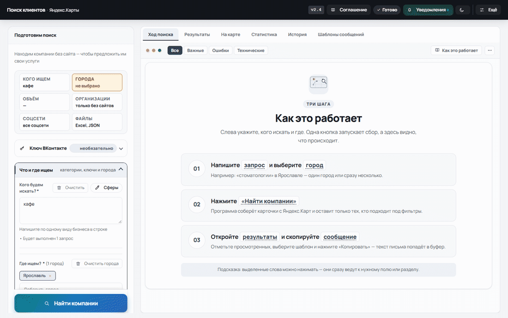
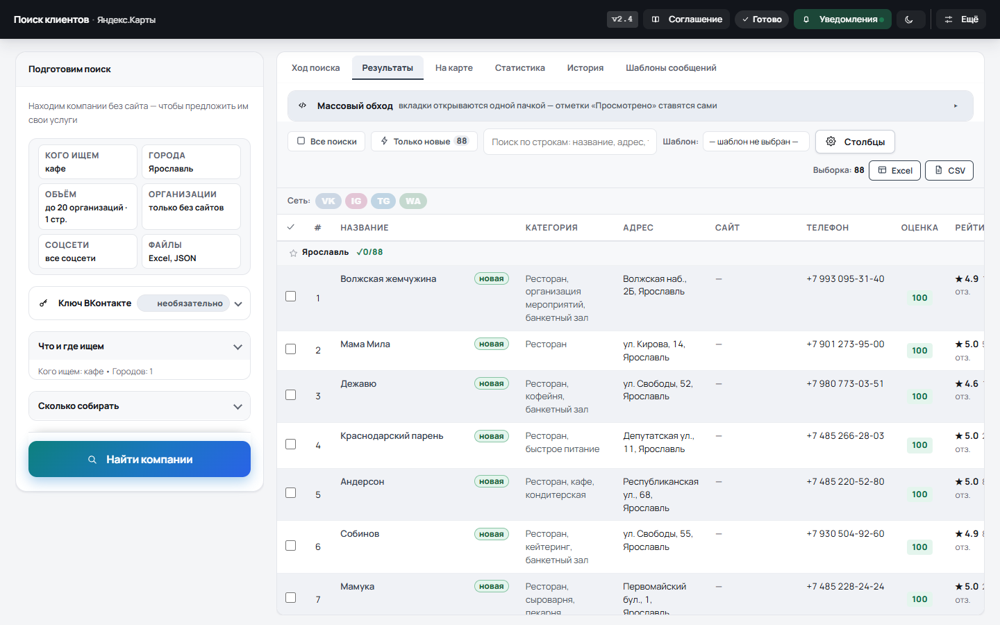
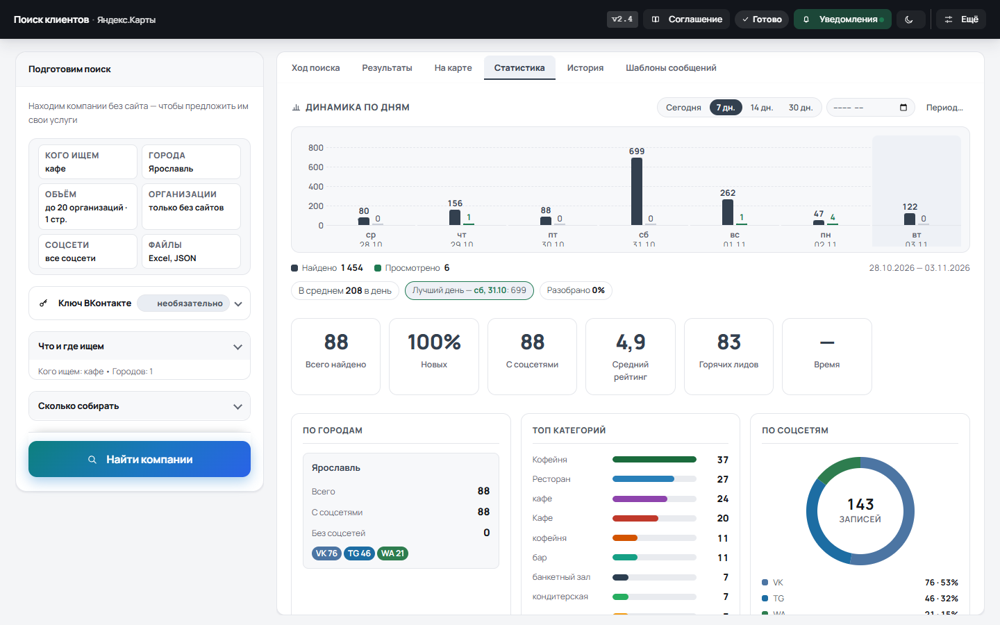
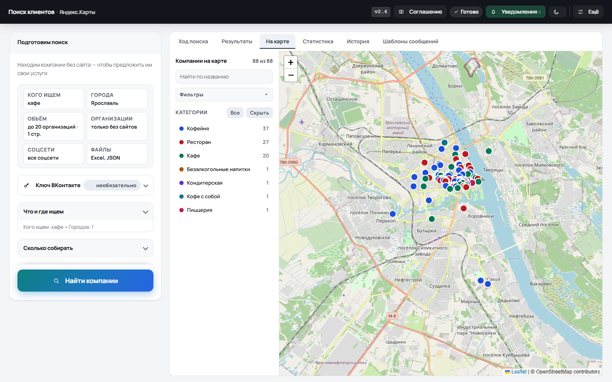
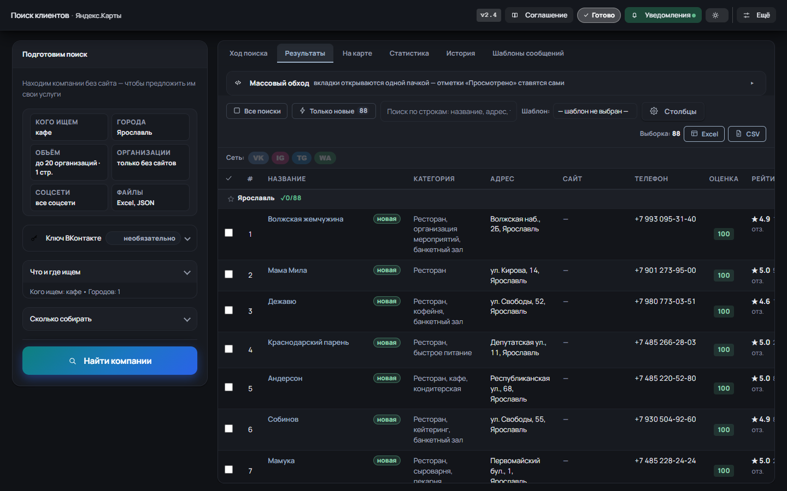
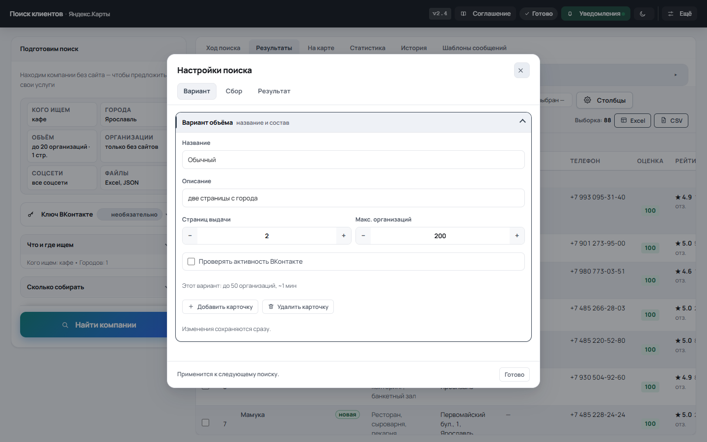

# 🔍 Поиск клиентов · Яндекс.Карты

[](https://github.com/ScarFace11/Yandex-Buisness-Parser/actions/workflows/ci.yml)
[](https://github.com/ScarFace11/Yandex-Buisness-Parser/releases/latest)
[](https://www.python.org/)
[](tests)
[](LICENSE)

**Локальное приложение для поиска компаний на Яндекс.Картах.** Находит организации без сайта, собирает телефоны и соцсети, считает оценку лида от 0 до 100 и выгружает базу в Excel или CSV. Работает на вашем компьютере, платные API не нужны.



## Что умеет

- **Ищет по нескольким городам и запросам** за один запуск, показывает живой прогресс и умеет ставить поиск на паузу.
- **Отбирает горячих лидов** по оценке 0–100: нет сайта, высокий рейтинг, много отзывов, телефон, соцсети и дорогая категория.
- **Показывает результаты на карте** и в таблице: фильтры, «Только новые», сортировка, разбор оценки по клику.
- **Помогает с первым сообщением**: шаблоны, массовый обход соцсетей и отметки «Просмотрено».
- **Считает статистику**: города, категории, соцсети, рейтинг, готовность лидов и новые организации.
- **Работает без интерфейса**: REST API на `127.0.0.1` и консольный режим `--run`.

## Как это работает

Приложение запускает локальный Flask-сервер и управляет установленным Chrome по Chrome DevTools Protocol. Страницы Яндекс.Карт читаются как обычным браузером: сначала собирается выдача, затем карточки организаций. Результаты сохраняются в `output/`: сначала сырые данные, после фильтров — готовые Excel/CSV/JSON. Всё остаётся на компьютере; сервер слушает только `127.0.0.1`.

Подробнее об архитектуре — [ARCHITECTURE.md](ARCHITECTURE.md).

## Быстрый старт

Нужен **Python 3.12** и **Google Chrome** (или другой браузер на Chromium).

```bash
git clone https://github.com/ScarFace11/Yandex-Buisness-Parser.git
cd Yandex-Buisness-Parser
pip install -r requirements.txt
python app.py
```

Откройте **http://localhost:5000**, укажите запрос и город и нажмите «Найти компании». Ключи вводить не нужно; токен ВКонтакте нужен только для необязательной проверки активности сообществ.

## Скачать

Готовые сборки — на странице [Releases](https://github.com/ScarFace11/Yandex-Buisness-Parser/releases/latest).

- **Windows:** `YandexBusinessParser-windows-x64-setup.exe` — установщик без прав администратора, данные в `%APPDATA%\YandexBusinessParser`. Либо portable-архив `.zip`.
- **macOS:** `.dmg` для Apple Silicon или Intel; приложение нужно перетащить в «Программы».
- Обновление встроено; на macOS новая версия скачивается из приложения и открывается как `.dmg`.

Инструкция по установке, SmartScreen, Gatekeeper и типичным ошибкам — в [руководстве пользователя](docs/GUIDE.md).

## Экраны







<details>
<summary>Тёмная тема и настройки поиска</summary>





</details>

## Документация

- [docs/GUIDE.md](docs/GUIDE.md) — руководство пользователя и FAQ.
- [ARCHITECTURE.md](ARCHITECTURE.md) — устройство приложения и поток данных.
- [CHANGELOG.md](CHANGELOG.md) — что изменилось по версиям.
- [docs/build.md](docs/build.md) — сборка `.exe`/`.app`, установщик, подпись macOS, CI/CD и тесты.
- [Issues](https://github.com/ScarFace11/Yandex-Buisness-Parser/issues) — сообщения об ошибках и предложения.

## Данные и безопасность

Файлы, настройки и ключи лежат только на вашем компьютере. Приложение не отправляет базу на сторонние серверы и не требует аккаунта. Перед использованием соблюдайте [пользовательское соглашение](docs/GUIDE.md) и правила площадок.

## Лицензия

MIT — см. [LICENSE](LICENSE).
